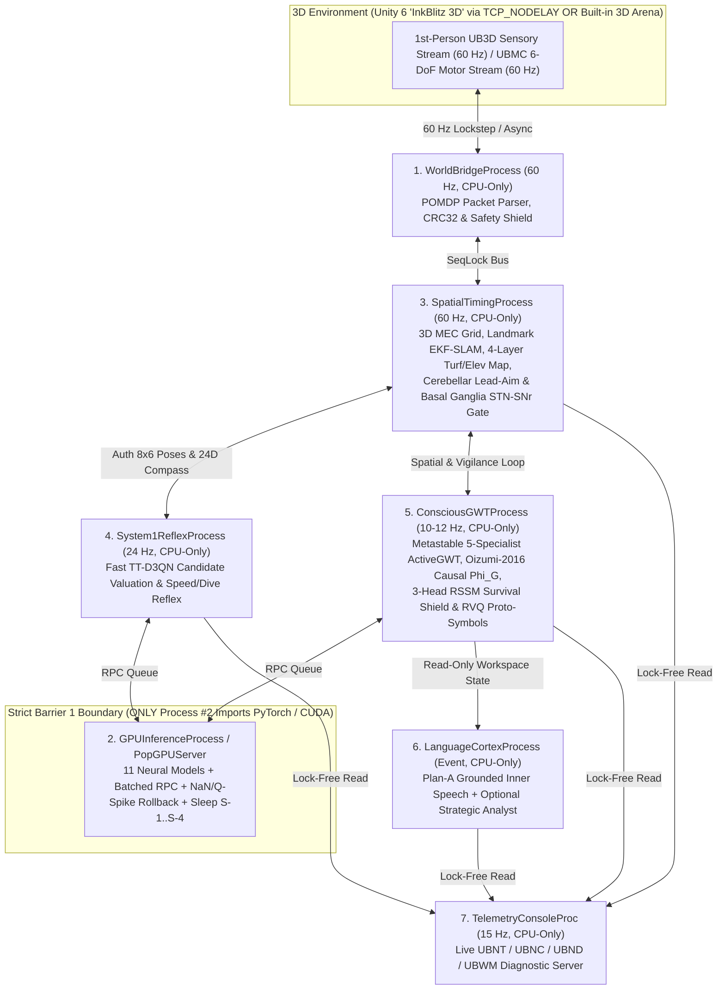

# Universal Brain 3D (v2.1) & InkBlitz 3D

**Closed-Loop Asynchronous Functionalist Whole-Brain Cognitive Architecture for Partially Observable 3D Environments**

[](CITATION.cff)
[](LICENSE)
[](requirements.txt)

> **日本語要約（Japanese Summary）**
> 本リポジトリ／アーカイブは、部分観測・動的3D空間でリアルタイム（60 Hz）に閉ループ動作する機能主義・全脳型認知アーキテクチャ **`Universal Brain 3D (v2.1)`** と、その検証用にゼロから独自構築された180度点対称3Dペイント領域＆コア搬送シミュレータ **`InkBlitz 3D`** の研究実装です。
> 単一GPU隔離原則（`Barrier 1`）を守る7プロセス非同期 `SeqLock + CRC32` 共有メモリ基盤の上に、4層アロセントリック海馬空間記憶＋静止ランドマーク限定 EKF-SLAM、小脳3D弾道偏差射撃、大脳基底核 `STN-SNr` 抑制ゲート、反実仮想脱交絡付き3ヘッド離散RSSM世界モデル、メタ安定化 GNWT（大域ワークスペース）点火とトップダウン知覚・海馬フィードバック、Oizumi et al. (2016) 準拠の時間遅れ因果統合情報量 $\Phi_G$、運動系完全隔離（`Plan-A`）内言、および睡眠記憶固定化（`S-1`〜`S-4`）を統合しています。**Unity 無しの Python 単体でも全7段階の自動検証スイート（`--mode verify_all`）と内蔵3Dアリーナ実験が完結します。**

---

## 1. Overview & Design Philosophy

**Universal Brain 3D (v2.1)** is a domain-agnostic cognitive engine engineered to investigate how heterogeneous neuro-cognitive subsystems—spatial memory, ballistic motor timing, world-model imagination, global workspace broadcasting, metacognitive self-modeling, grounded inner speech, and offline sleep consolidation—interact inside a **real-time 60 Hz sensorimotor closed loop** under strict partial observability (1st-person POMDP).

Rather than claiming biological realism at the ion-channel level or asserting phenomenal sentience, this project adopts a **testable functionalist systems-engineering approach** (Yamakawa, 2021; Butlin et al., 2023):
1. **Modular Walking Skeleton First**: Establish a fault-tolerant, lock-free multi-rate architecture where every inter-region pathway carries explicit, empirically auditable tensors and invariants.
2. **Honest 1st-Person Partial Observability**: No omniscient map or wall-penetrating coordinates are exposed to the agent; occluded territory decays toward epistemic uncertainty (`0.0`), and stealth-submerged opponents vanish from both entity lists and foveal ray silhouettes.
3. **Empirical Falsifiability**: Every module—including world-model counterfactual rollouts (`UBWM`), GWT specialist handoffs, Plan-A inner-speech motor isolation, and causal $\Phi_G$—is verified continuously via built-in deterministic self-tests and live diagnostic telemetry.

---

## 2. System Architecture (7-Process Lock-Free Bus & `Barrier 1`)

To prevent Python GIL contention and PyTorch CUDA context duplication on single-GPU workstations, the runtime splits into **7 OS processes** communicating over 64-byte-aligned double-buffered `SeqLock + CRC32` shared-memory buses:



### Architectural Invariants & Fault Tolerance
- **Strict `Barrier 1` Isolation**: Only `GPUInferenceProcess` (or `PopGPUServer` during parallel self-play) initializes `torch`. All CPU processes assert `"torch" not in sys.modules`, serializing IPC weight snapshots strictly as `numpy.ndarray` to eliminate Windows pagefile exhaustion.
- **100% Anchor Rollback on Numerical Faults**: If an online gradient step or extreme reward spike induces `NaN`/`Inf` or a Q-value spike exceeding safety bounds, `WholeBrainNeuralEngineWrapper` immediately restores the last verified anchor weights and clears Adam optimizer momentum (`optimizer.state.clear()`).

---

## 3. Neuro-Cognitive Mechanisms & Closed-Loop Information Flow

1. **Allocentric 4-Layer Cognitive Field Map & Mid-Episode Respawn Continuity**:
   - Tracks `48x48` cells across obstacle occupancy (`occ`), dynamic paint-territory valence (`surface` $\in [-1, +1]$ with epistemic decay toward `0.0` when unobserved), local elevation/cover (`elev`), and visit freshness (`visit`).
   - Stationary-landmark-only EKF-SLAM prevents moving opponents or objectives from corrupting self-localization. Upon mid-match elimination and respawn (`flags |= 16`), pose drift and transient threat traces re-anchor cleanly while preserving acquired stage and turf memory.
2. **Decoupled 6-DoF Locomotion vs. Cerebellar Ballistic Lead-Aim & Basal Ganglia Gate**:
   - Motor candidates encode `[move_x, move_y, move_z, aim_yaw, aim_pitch, speed_scale]`, enabling retreat-while-firing (*kiting*) with analytic gravity-compensated 3D projectile lead interception (`Cerebellar3DKinematicPredictorV2`) and `STN-SNr` hyperdirect braking (Frank, 2006; Cisek et al., 2009), exempted during active hazard evasion (`M4`).
3. **3-Head Multi-Step Categorical RSSM & Counterfactual De-Confounding**:
   - Built on a `32x32` categorical latent state (`horizon=3`, 4-step chunk BPTT; Hafner et al., 2023), predicting step reward, survival probability, and tactical advantage across all 8 action candidates. Includes counterfactual open-space freeze de-confounding (`cf_loss`) so unchosen stationary actions (`M7`) do not inherit optimistic survival bias during active escapes, and streams live `[Obs(t) | PriorPred(t) | CF Rollout]` verification packets (`UBWM`, 904 B).
4. **Metastable GNWT Ignition & Bidirectional `GWT <-> Perception / Hippocampus` Loop**:
   - Five cortical specialists `[P: Perceptual, I: Hippocampal, W: World-Model, M: Motor/BG, S: Self-Model]` compete for entry into `ActiveGWTWorkspace3D` (Baars, 1988; Dehaene et al., 2011, 2017).
   - To prevent specialist monopoly lock-in, workspace competition incorporates short-term occupancy adaptation (`hab_trace`) balanced against phasic prediction-error salience (`novelty_5`). Broadcasted workspace states feed back at $t-1 \to t$ into thalamocortical feature gain (`z_td`), object-centric slot queries (`td_slot_prior`; Rao & Ballard, 1999; Locatello et al., 2020), and hippocampal epistemic scan vigilance—strictly without fabricating physical occupancy or SLAM landmarks.
5. **Higher-Order Self-Model & Oizumi-2016 Lagged Causal $\Phi_G$**:
   - `CoarseSelfModel3D` predicts the agent's own attentional schema (`gwt_alpha`) and somatic transition from efference copies (Graziano, 2013; Lau & Rosenthal, 2011), routing `self_surprise` into workspace ignition threshold, strategic horizon, `STN` braking, and exploration temperature.
   - Integrated information is quantified online across the 5 cortical modules via lagged causal transition disconnection (Oizumi, Tsuchiya, & Amari, 2016):
     $$\Phi_G = \min_{\pi} \min_{q \in \mathcal{M}_G(\pi)} D_{\mathrm{KL}}\!\left(p(X^{t-1}, X^t) \,\|\, q(X^{t-1}, X^t)\right)$$
     evaluated over all 15 bipartitions with row-wise off-diagonal ridge regularization and finite-sample Wilks debiasing, streaming the active Minimum Information Partition (MIP) bitmask live via `UBNT`.
6. **Plan-A Motor-Isolated Inner Speech & Offline Sleep Consolidation (`S-1..S-4`)**:
   - `EndogenousBrocaWernickeCortex` grounds discrete RVQ workspace symbols via MIL-InfoNCE while enforcing `max|Q_on - Q_off| == 0.0` motor isolation by default (`allow_broca_motor_bias = False`; Vygotsky, 1934/1986). Between PBT generations, `PopGPUServer` executes 4-stage offline sleep (`S-1` NREM prioritized replay, `S-2` REM counterfactual rollout, `S-3` homeostatic synaptic downscaling, `S-4` cortical schema distillation).

---

## 4. Quick Start & Built-in Verification

### Prerequisites
- Python `3.10+` (`numpy>=1.26.0`, `torch>=2.2.0`; CUDA GPU recommended, CPU fallback supported).
- **Unity is NOT required** to run the cognitive engine, built-in 3D tactical arena, or verification suites.

```bash
pip install -r requirements.txt
```

### 1-Command Deterministic Verification Suites (No Unity Required)
```bash
# 7-Stage End-to-End Brain Verification (IPC/CRC32, Barrier 1, SLAM, 7-Proc Live Arena,
# Plan-A Isolation, 11-Model Gradients, NaN Rollback, Sleep S-1..S-4, & Oizumi-2016 Phi_G)
python -B universal_brain_3d_core.py --mode verify_all

# World-Model Visual/Depth Prediction & Counterfactual Rollout Verification
python -B universal_brain_3d_core.py --mode verify_world_model

# Single-GPU Multi-Slot 180-deg Symmetric Self-Play PBT & Sleep League Verification
python -B arena_pbt_trainer.py --mode verify_pbt
```

### Running Headless Built-in 3D Arena or Launching with `InkBlitz 3D` (Unity)
| Use Case | Command / Procedure |
| :--- | :--- |
| **Interactive GUI Launcher (Recommended with Unity Build)** | Place `Build/InkBlitz3D/InkBlitz3D.exe` inside the repository folder (with `.venv` or `venv` configured) and launch **`InkBlitz3D.exe`**. Select **PBT Training** or **Inference Spectate** directly in the launcher UI. |
| **Headless Built-in 3D Arena (Pure Python)** | `python -B universal_brain_3d_core.py --mode play --env builtin_3d --task-profile turf_objective` |
| **Manual CLI Unity TCP Session (1v1)** | Start `python -B universal_brain_3d_core.py --mode play --env unity_tcp --port 50055 --task-profile turf_objective`, then connect Unity on `127.0.0.1:50055`. |
| **Parallel Competitive Self-Play PBT** | `python -B arena_pbt_trainer.py --mode train --env builtin_3d --pop-size 4 --generations 8` |

Key ablation flags on `universal_brain_3d_core.py`: `--timing-mode {learned_bg,heuristic,passthrough}`, `--spatial-mode {full_slam,ego_only}`, `--visual-mode {fovea_only,neural_stereo,calibrate}`, `--allow-broca-motor-bias` (opt-in `Plan-B` test), `--load-weights <path.pt>`.

---

## 5. Unity 3D Integration (`InkBlitz 3D`) & Binary Wire Protocol

**Is Unity mandatory?** **No.** All core cognitive processing, built-in 3D arena physics, and the 7-stage verification suite run entirely in Python + NumPy + PyTorch.

**Why include the Unity 6 (`InkBlitz 3D`) simulator?**
1. **Continuous 3D Manifold & Raycast Occlusion**: Tests 1st-person POMDP perception, C1-smooth elevation slopes, ballistic projectile arcs, 4-second ink-dive stealth, tug-of-war `BlitzCore` barrier detonation, and late-game 3D projectile deflection in a symmetric `24m x 32m` arena.
2. **Binocular Stereo Depth Calibration**: Supports optional `64x64x3 x 2` stereo RGB24 frames (`UB3D` v2) to train and calibrate retinotopic depth cortex models.
3. **Real-Time Neuro-Telemetry HUDs**: Streams live cortical neural sheets, Oizumi-2016 $\Phi_G$ causal manifolds with dynamic MIP cut overlays, `UBWM` world-model predictions (`03 WORLD MODEL`), and empirical 9-module health diagnostics (`04 BRAIN DIAGNOSTIC`).

| Packet Magic | Direction | Size (Bytes) | Role & Payload Summary |
| :--- | :--- | :--- | :--- |
| **`UB3D` (v1 / v2)** | Unity $\to$ Python (60 Hz) | `6,296` / `34,968` | Ego kinematics, 16D somatic `proprio`, `flags` (incl. bit 4 mid-episode respawn), up to 32 LOS-filtered semantic entities, `16x16x3` foveal ray patch (+ stereo `64x64x3x2` RGB in v2), CRC32. |
| **`UBMC`** | Python $\to$ Unity (60 Hz) | `128` | Decoupled 6-DoF target pose (`move_xyz`, `aim_yaw`, `aim_pitch`, `speed_scale`), discrete motor verb, `commit_gate_open`, `hold_reason_id`, grounded inner-speech UTF-8 preview, CRC32. |
| **`UBNT`** | Python $\to$ HUD (15 Hz) | `3,636` | Full 4-layer `48x48` cognitive map, `gwt_w[128]`, `gwt_alpha[5]`, `ignition`, Oizumi-2016 `phi_bits` + 5-bit `mip_cut_mask`, 8-candidate `Q`/policy/survival arrays, EKF-SLAM drift, CRC32. |
| **`UBWM`** | Python $\to$ HUD (15 Hz) | `904` | Live world-model visual verifier: `16x16` next-step prior RGB/salience prediction, absolute prediction-error map, depth MAE, KL surprise, and 8-candidate counterfactual spread, CRC32. |
| **`UBNC` / `UBND`** | Python $\to$ HUD (15 Hz) | `16` / `536` | Dynamic architecture graph topology & live pathway activation diagnostics, CRC32. |

---

## 6. Limitations & Future Research Roadmap (2027+)

### Current Limitations
- **Single-Node Execution**: Designed for single-workstation execution (`Barrier 1` single-GPU server + multi-core CPU processes); distributed multi-node IPC is not yet implemented.
- **Coarse Functionalist Granularity**: Neural modules use rate-coded PyTorch layers (`LayerNorm`, `GELU`, `GRU`, `Transformer`) coupled with analytic EKF-SLAM and ballistic kinematics for reliable 60 Hz control, rather than biophysical spiking dynamics.
- **Default Motor Isolation of Inner Speech (`Plan-A`)**: Endogenous inner speech is intentionally disconnected from motor action logits by default to prevent self-referential action freezing; causal verbal goal steering remains an opt-in research mode.

### Future Roadmap (2027+ — Selective WBRA & Biophysical Refinement)
- **Selective WBRA Circuit-Motif Integration**: Stepwise adoption of Whole Brain Reference Architecture (WBRA; Yamakawa, 2021) motifs—such as explicit hippocampal `CA3-CA1` episodic indexing, thalamic `Pulvinar/TRN` precision routing, and multi-neuromodulator gain—via non-breaking Shadow (`Plan-A`) $\to$ Zero-Gate grafting.
- **Controlled `Plan-B` Prefrontal Modulation**: Safe indirect modulation of high-level goal priors via grounded inner speech under survival-shield constraints.
- **Progressive Spiking / Local-Plasticity Exploration**: Investigating continuous-time circuit motifs and three-factor local plasticity where computationally justified.

---

## 7. Transparent AI Co-Development Statement & References

### AI Co-Development Disclosure
In accordance with contemporary open-science transparency standards, the author (**Alpha496**) conceived the overall system architecture, neuro-cognitive hypotheses, safety invariants, domain mechanics, and experimental evaluation criteria, while utilizing large language model coding assistants (Google Gemini) as an implementation, refactoring, and differential-verification partner. All architectural invariants and empirical test suites (`verify_all`, `verify_world_model`, `verify_pbt`, and the 23-check Unity mechanics suite) were deterministically executed and validated locally.

### References
1. Baars, B. J. (1988). *A Cognitive Theory of Consciousness*. Cambridge University Press.
2. Dehaene, S., Changeux, J.-P., & Naccache, L. (2011). Experimental and theoretical approaches to conscious processing. *Neuron*, 70(2), 200–227.
3. Dehaene, S., Lau, H., & Kouider, S. (2017). What is consciousness, and could machines have it? *Science*, 358(6362), 486–492.
4. Butlin, P., Long, R., Elmoznino, E., Bengio, Y., Birch, J., et al. (2023). Consciousness in Artificial Intelligence: Insights from the Science of Consciousness. *arXiv preprint arXiv:2308.08708*.
5. Oizumi, M., Tsuchiya, N., & Amari, S. (2016). Unified framework for information integration based on information geometry. *Proceedings of the National Academy of Sciences (PNAS)*, 113(51), 14817–14822.
6. Rao, R. P. N., & Ballard, D. H. (1999). Predictive coding in the visual cortex: a functional interpretation of some extra-classical receptive-field effects. *Nature Neuroscience*, 2(1), 79–87.
7. Friston, K. (2010). The free-energy principle: a unified brain theory? *Nature Reviews Neuroscience*, 11(2), 127–138.
8. Graziano, M. S. A. (2013). *Consciousness and the Social Brain*. Oxford University Press.
9. Lau, H., & Rosenthal, D. (2011). Empirical support for higher-order theories of conscious awareness. *Trends in Cognitive Sciences*, 15(8), 365–373.
10. Hafner, D., Pasukonis, J., Ba, J., & Lillicrap, T. (2023). Mastering Diverse Domains through World Models. *arXiv preprint arXiv:2301.04104*.
11. Locatello, F., Weissenborn, D., Unterthiner, T., Mahendran, A., Heigold, G., Uszkoreit, J., Dosovitskiy, A., & Kipf, T. (2020). Object-Centric Learning with Slot Attention. *Advances in Neural Information Processing Systems (NeurIPS)*, 33, 11525–11538.
12. Frank, M. J. (2006). Hold your horses: Impulsivity, deep brain stimulation, and medication in parkinsonism. *Neural Networks*, 19(8), 1120–1136.
13. Cisek, P., Puskas, G. A., & El-Murr, S. (2009). Decisions in changing conditions: The urgency-gating model. *Journal of Neuroscience*, 29(37), 11560–11571.
14. Yamakawa, H. (2021). The whole brain architecture approach: Accelerating the development of artificial general intelligence by referring to the brain. *Neural Networks*, 144, 478–495.
15. Vygotsky, L. S. (1934/1986). *Thought and Language*. MIT Press.
