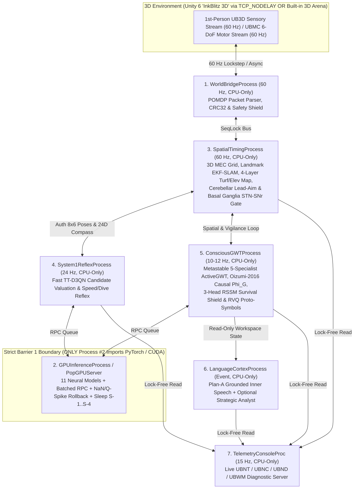

# Universal Brain 3D (v2.1) & InkBlitz 3D

**Closed-Loop Asynchronous Functionalist Whole-Brain Cognitive Architecture for Partially Observable 3D Environments**

[](CITATION.cff)
[](LICENSE)
[](LICENSE_UNITY_MIT.txt)
[](requirements.txt)
[](https://doi.org/10.5281/zenodo.24417716)

> **日本語要約（Japanese Summary）**
> 本リポジトリは、壁裏やインク潜伏中の敵が見えない「正直な一人称視点（部分観測3D空間）」でリアルタイム（60 Hz）に閉ループ動作する全脳型認知アーキテクチャ **`Universal Brain 3D (v2.1)`** と、その検証用にゼロから自作した180度点対称の3D領域塗り＆コア搬送対戦環境 **`InkBlitz 3D`** の研究実装です。
> 1つの巨大ネットワークで全てを処理するのではなく、OSのように分離された7つの非同期プロセス（単一GPU専有1＋CPU6）の上で、**①海馬の空間地図記憶（EKF-SLAM）**、**②小脳の3D偏差射撃とSystem 1の高速反射（60/24 Hz）**、**③世界モデルによる3手先の反実仮想予測と大域ワークスペース（GNWT）の意識統合（10 Hz）**、**④自己モデルと因果統合情報量 $\Phi_G$ のリアルタイム計測**、**⑤運動系から安全隔離された内言と世代間の睡眠学習（S-1〜S-4）** を同時に協調動作させています。**Unity無しのPython単体でも、全7段階の自動検証スイート（`--mode verify_all`）と内蔵3Dアリーナ実験がそのまま完結します。**

---

## 1. Overview & Design Philosophy

**Universal Brain 3D (v2.1)** is a domain-agnostic cognitive engine built to study how distinct brain-inspired subsystems—spatial memory, fast motor reflexes, world-model imagination, conscious workspace broadcasting, metacognitive self-monitoring, grounded inner speech, and offline sleep—work together inside a **real-time 60 Hz sensorimotor closed loop** under strict 1st-person partial observability (POMDP).
To ground these mechanisms in a demanding dynamic task without relying on commercial game assets, the engine is paired with **InkBlitz 3D**—an original symmetric 3D tactical arena (with a pure-Python headless counterpart) where agents paint territory for high-speed stealth movement and escort a central `BlitzCore` objective.

Rather than claiming ion-channel biological realism or asserting phenomenal consciousness, this project takes a **testable functionalist systems-engineering approach** (Yamakawa, 2021; Butlin et al., 2023):
1. **Whole-System Integration First**: Run all fast and slow cognitive loops concurrently over a fault-tolerant, lock-free multi-process runtime ("a real-time cognitive microkernel") with explicit inter-region interfaces.
2. **Honest 1st-Person Partial Observability**: No omniscient map or wall-penetrating coordinates are ever exposed to the agent; unobserved territory gradually decays back toward uncertainty (`0.0`), and stealth-submerged opponents vanish from vision.
3. **Empirical Falsifiability**: Every cognitive claim—world-model future rollouts, global workspace handoffs, motor-isolated inner speech, and causal integration ($\Phi_G$)—is continuously audited by deterministic self-tests and live telemetry.

---

## 2. System Architecture (7-Process Lock-Free Bus & `Barrier 1`)

To prevent Python GIL contention and PyTorch CUDA context duplication on single-GPU workstations, the runtime splits into **7 OS processes** communicating over 64-byte-aligned double-buffered `SeqLock + CRC32` shared-memory buses:



### Architectural Invariants & Fault Tolerance
- **Strict `Barrier 1` Isolation**: Only `GPUInferenceProcess` (or `PopGPUServer` during parallel self-play) initializes `torch`. All CPU processes assert `"torch" not in sys.modules`, serializing IPC weight snapshots strictly as `numpy.ndarray` to eliminate Windows pagefile exhaustion.
- **100% Anchor Rollback on Numerical Faults**: If an online gradient step or extreme reward spike induces `NaN`/`Inf` or a Q-value spike exceeding safety bounds, `WholeBrainNeuralEngineWrapper` immediately restores the last verified anchor weights and clears Adam optimizer momentum (`optimizer.state.clear()`).

### Repository File Structure
* `universal_brain_3d_core.py`: Main CLI entry point, 7-process orchestrator, and 7-stage `verify_all` self-test suite.
* `brain3d_config_ipc.py`: Zero-PyTorch (`Barrier 1`) config, `SeqLock + CRC32` shared-memory buses, and `UB3D`/`UBMC` wire protocol.
* `brain3d_torch_models.py`: PyTorch definitions for all 11 neural modules (Retinotopic/Slot vision, 3-Head Categorical RSSM, `ActiveGWTWorkspace3D`, `CoarseSelfModel3D`, `TT-D3QN`, `EndogenousBrocaWernickeCortex`).
* `brain3d_neural_engine.py`: Single-GPU batched RPC wrapper, `NaN`/Q-spike anchor rollback, Oizumi-2016 causal $\Phi_G$ estimator, and 4-phase offline sleep (`S-1..S-4`).
* `brain3d_spatial_timing.py`: 60 Hz 3D grid/HD cells, stationary-landmark EKF-SLAM, `48x48` 4-layer map, cerebellar 3D lead-aim, and `STN-SNr` timing gate.
* `brain3d_cognitive_procs.py`: CPU worker loops for `System1ReflexProcess`, `ConsciousGWTProcess`, `LanguageCortexProcess`, and live telemetry servers.
* `brain3d_arena_env.py` & `task_profiles_3d.py`: Pure-Python built-in 3D tactical arena and domain-agnostic embodiment profiles (`turf_objective`, etc.).
* `arena_pbt_trainer.py`: Single-GPU (`PopGPUServer`) 180-degree symmetric self-play league (DAgger bootstrap, PFSP matchmaking, Elo tracking, and inter-generation sleep).
* `strategy_knowledge_engine.py` & `companion_voice_io.py`: Optional strategic knowledge distillation and read-only voice/commentary utilities.
* `generate_sfx_pack.py`: Procedural 48 kHz mathematical synthesizer generating all original game audio from scratch.
* `unity_bridge_template/` & Unity C# (`InkBlitz3D`): MIT-licensed 60 Hz TCP sensorimotor bridge, `InkBlitz 3D` arena mechanics, and real-time neural HUDs.

---

## 3. Whole-Brain Architecture: Step-by-Step Cognitive Flow

Standard deep reinforcement learning typically compresses perception and control into a single monolithic network (`observation -> network -> action`). When fast survival reflexes (16 ms) and deeper multi-step planning (100 ms) are forced into one synchronous loop, the agent either stalls while "thinking" or sacrifices foresight for speed.

**Universal Brain 3D (v2.1)** resolves this by organizing cognition into **multi-timescale functional brain regions** that run concurrently and close the loop from 1st-person sensation to motor execution and offline sleep:

```text
[Stage 1: 1st-Person Senses (60 Hz)]
       │  Line-of-sight entities, 16x16 foveal rays, directional audio, 16D body state
       ▼
[Stage 2: Hippocampal-Parietal Spatial Memory (60 Hz)]
       │  Landmark-only EKF-SLAM + 48x48 4-layer mental map (obstacles, paint decay, elevation, visits)
       ▼
[Stage 3: 6-DoF Body/Aim, Cerebellum & System-1 Reflex (60 Hz / 24 Hz)]
       │  8 tactical candidates + independent 3D lead-aim + TT-D3QN fast valuation + BG safety brake
       ▼
[Stage 4: System-2 World Model & Global Workspace Broadcast (10-12 Hz)]
       │  3-step counterfactual imagination (Survival Shield) + 5-specialist conscious ignition
       ├──▶ Top-Down Feedback (t-1 -> t): Biases visual gain, object slots & spatial scan vigilance
       ▼
[Stage 5 & 6: Self-Model, Causal Phi_G, Read-Only Inner Speech & Offline Sleep (S-1..S-4)]
```

### Stage 1: Honest 1st-Person Perception (Sight, Sound, & Somatic State — 60 Hz)
Unlike omniscient game AIs that read global coordinates, the brain only receives what its body can physically sense at 60 Hz (`UB3D`):
- **Foveal & Optional Stereo Vision**: A `16x16` raycast foveal patch directly ahead samples floor paint state, walls, and local elevation (expandable to `64x64x2` binocular RGB frames in `UB3D` v2).
- **Strict Line-of-Sight Entities**: Up to 32 semantic objects within the camera frustum that pass raycast occlusion checks. Opponents hiding behind cover or submerged in their own ink **completely vanish from visual input**, leaving only close-range splash cues on the directional audio channel (`audio_dir`).
- **16D Proprioception (`proprio`)**: Internal bodily state including health, ink reserve, surface/stealth state, objective progress, and mid-episode respawn status.

### Stage 2: Hippocampal-Parietal Spatial Memory & Self-Localization (60 Hz)
Because 1st-person vision covers only a narrow cone, `SpatialTimingProcess` continuously integrates fleeting glimpses into a persistent world map:
- **Stationary-Landmark-Only EKF-SLAM**: Coupling 3D grid/head-direction coding with Extended Kalman Filter SLAM, the brain corrects self-position drift using *only* static geometry (walls, blocks, goal pedestals)—never moving players or the mobile objective—preventing dynamic entities from corrupting localization.
- **4-Layer Allocentric Cognitive Field Map (`48x48`)**: Tracks **(1) obstacle occupancy**, **(2) territory paint valence** (`+1` friendly to `-1` enemy, which gradually decays toward `0.0` epistemic uncertainty when left unobserved so the brain knows its memory has grown stale), **(3) 3D elevation/cover**, and **(4) exploration freshness**.
- **Mid-Episode Respawn Continuity (`flags |= 16`)**: When eliminated and returned to spawn, the brain resets local pose drift and short-term threat traces while **retaining the stage layout and territory map** learned earlier in the match.

### Stage 3: Tactical Candidates, Decoupled 6-DoF Aim, & Fast "System 1" Reflexes (60 / 24 Hz)
Rather than emitting raw, jittery motor noise, the spatial-motor loop structures movement into interpretable tactical options:
- **8 Tactical Action Candidates**: Every cycle, the spatial cortex proposes 8 concrete maneuvers grounded in local geometry (e.g., *advance objective*, *expand unpainted frontier*, *flank via cover*, *strafe-engage*, *dive/evade to friendly ink*, *hold/ambush*) alongside a 24D spatial compass.
- **Decoupled 6-DoF Locomotion vs. Cerebellar Lead-Aim**: Body velocity (`move_xyz`) is completely decoupled from weapon orientation (`aim_yaw, aim_pitch`). The body can retreat into friendly ink while the **Cerebellar kinematic predictor** (`Cerebellar3DKinematicPredictorV2`) independently solves gravity-compensated 3D projectile interception against moving targets (*kiting*).
- **Fast System-1 Valuation (`24 Hz`) & Basal Ganglia Brake (`60 Hz`)**: `System1ReflexProcess` (`TT-D3QN`) rapidly scores all 8 candidates so the body stays responsive even before slow deliberation finishes. Simultaneously, a **Basal Ganglia `STN-SNr` timing gate** acts as a 60 Hz hyperdirect brake against impulsive commitment under hazard—while explicitly exempting active evasion maneuvers so emergency escapes are never blocked (Frank, 2006; Cisek et al., 2009).

### Stage 4: Slow "System 2" World-Model Foresight & Conscious Workspace (`10–12 Hz`)
In parallel with fast reflexes, `ConsciousGWTProcess` performs multi-step imagination and cross-module integration:
- **Counterfactual World Model & Survival Shield**: Using a `32x32` discrete latent state (`horizon=3` categorical RSSM; Hafner et al., 2023), the world model simulates what happens over the next three steps for *each* of the 8 candidate actions—predicting **reward**, **survival probability**, and **tactical advantage**. Counterfactual de-confounding ensures stationary actions in exposed areas do not inherit false survival optimism from successful dodges. If System 1's reflex choice violates the world model's survival threshold, System 2 overrides it and broadcasts live visual/depth predictions (`UBWM`) for verification.
- **Metastable Global Neuronal Workspace (`ActiveGWTWorkspace3D`)**: Five cortical specialists—**Perceptual (`P`)**, **Hippocampal (`I`)**, **World-Model (`W`)**, **Motor/BG (`M`)**, and **Self-Model (`S`)**—compete to "ignite" a shared 128D workspace broadcast (Baars, 1988; Dehaene et al., 2011, 2017). Short-term synaptic habituation prevents any single specialist from monopolizing consciousness, while sudden prediction errors trigger rapid attentional switching.
- **Closed Top-Down Loop (`t-1 -> t`)**: Workspace broadcasts feed back into the next cycle's thalamocortical visual gain, object-centric slot attention queries, and hippocampal scan vigilance—guiding *where to attend and explore next* without fabricating fake obstacles or landmarks into the physical map (Rao & Ballard, 1999; Friston, 2010; Locatello et al., 2020).

### Stage 5: Metacognitive Self-Model & Causal Integration Diagnostics ($\Phi_G$)
To prevent blind overconfidence under unfamiliar dynamics, the architecture monitors its own internal coherence:
- **Higher-Order Self-Model (`CoarseSelfModel3D`)**: Using motor efference copies, the brain predicts its own upcoming attentional focus and bodily state transition (Graziano, 2013; Lau & Rosenthal, 2011). High `self_surprise` (when internal or somatic reality deviates from expectation) dynamically adjusts workspace ignition thresholds, planning horizon, basal-ganglia caution, and exploration temperature.
- **Online Causal Integration ($\Phi_G$)**: Rather than treating "whole-brain integration" purely as a metaphor, the engine continuously measures lagged causal information flow (`t-1 -> t`) across all 15 bipartitions of the 5 cortical specialists (Oizumi, Tsuchiya, & Amari, 2016):
  $$\Phi_G = \min_{\pi} \min_{q \in \mathcal{M}_G(\pi)} D_{\mathrm{KL}}\!\left(p(X^{t-1}, X^t) \,\|\, q(X^{t-1}, X^t)\right)$$
  streaming both $\Phi_G$ and the weakest inter-module link (Minimum Information Partition) live to the diagnostic HUD (`UBNT`).

### Stage 6: Motor-Isolated Inner Speech (`Plan-A`) & 4-Phase Offline Sleep (`S-1..S-4`)
Finally, two slower loops handle symbolic interpretability and long-term memory consolidation:
- **Grounded Inner Speech with Strict Motor Isolation (`Plan-A`)**: `LanguageCortexProcess` quantizes workspace states into discrete proto-symbols (`RVQ`) and grounds short tactical phrases via contrastive learning (`MIL-InfoNCE`; Vygotsky, 1934/1986). By default (`allow_broca_motor_bias = False`), this inner-speech stream has **strictly zero write access to motor logits (`max|Q_on - Q_off| == 0.0`)**—allowing researchers to read what context the brain is attending to without risking self-generated verbal tokens (*"hold position"*) freezing real-time combat control.
- **4-Phase Offline Sleep Consolidation (`S-1` to `S-4`)**: Between competitive self-play generations (`arena_pbt_trainer.py`), the GPU server enters an offline sleep cycle: **`S-1` NREM prioritized replay** of high-surprise episodes, **`S-2` REM counterfactual dreaming** inside the world model, **`S-3` homeostatic synaptic downscaling** to prevent weight runaway, and **`S-4` cortical policy/schema distillation**.

### Dynamic Cognitive Arbitration During Live Play
Depending on real-time tactical risk and prediction error, control authority shifts fluidly across timescales without stalling the 60 Hz motor loop:

| Tactical Situation | Dominant Loop | Active Brain Regions | Behavioral Effect |
| :--- | :--- | :--- | :--- |
| **Clear / Low Risk** | **System 1 Reflex** (`24 Hz`) | `TT-D3QN` + Spatial Compass | Fast, fluid turf expansion and objective approach with zero planning lag. |
| **Line-of-Sight Engagement** | **Sensorimotor + Gate** (`60 Hz`) | Cerebellum + Basal Ganglia `STN-SNr` | Independent 3D ballistic lead-aim (*kiting*) while `STN-SNr` suppresses premature lunges. |
| **Predicted Lethal Trap** | **System 2 Override** (`10–12 Hz`) | 3-Head RSSM (`Survival Shield`) + `ActiveGWT` | World model foresees multi-step elimination risk, vetoes risky System-1 choices, and ignites global re-planning. |
| **Immediate Survival Crisis** | **Active Escape Exemption** (`60 Hz`) | `STN-SNr` Veto Bypass + Stealth Dive | Unlocks basal-ganglia braking exclusively for friendly-ink dive evasion so the agent never freezes under fire. |


---


## 4. Quick Start & Built-in Verification

### Prerequisites
- Python `3.10+` (`numpy>=1.26.0`, `torch>=2.2.0`; CUDA GPU recommended, CPU fallback supported).
- **Unity is NOT required** to run the cognitive engine, built-in 3D tactical arena, or verification suites.

```bash
pip install -r requirements.txt
```

### 1-Command Deterministic Verification Suites (No Unity Required)
```bash
# 7-Stage End-to-End Brain Verification (IPC/CRC32, Barrier 1, SLAM, 7-Proc Live Arena,
# Plan-A Isolation, 11-Model Gradients, NaN Rollback, Sleep S-1..S-4, & Oizumi-2016 Phi_G)
python -B universal_brain_3d_core.py --mode verify_all

# World-Model Visual/Depth Prediction & Counterfactual Rollout Verification
python -B universal_brain_3d_core.py --mode verify_world_model

# Single-GPU Multi-Slot 180-deg Symmetric Self-Play PBT & Sleep League Verification
python -B arena_pbt_trainer.py --mode verify_pbt
```

### Running Headless Built-in 3D Arena or Launching with `InkBlitz 3D` (Unity)
| Use Case | Command / Procedure |
| :--- | :--- |
| **Interactive GUI Launcher (Recommended with Unity Build)** | Download the Windows 64-bit standalone archive (e.g., InkBlitz3D_Win64.zip / inkblitz_3d_v2_1_win64_bundle.zip) from GitHub Releases or Zenodo, extract `Build/InkBlitz3D/` and `checkpoints/` into the repository root (with `.venv` or `venv` configured), and launch **`InkBlitz3D.exe`** to run **PBT Training** or **Inference Spectate** from the GUI. |
| **Headless Built-in 3D Arena (Pure Python)** | `python -B universal_brain_3d_core.py --mode play --env builtin_3d --task-profile turf_objective` |
| **Manual CLI Unity TCP Session (1v1)** | Start `python -B universal_brain_3d_core.py --mode play --env unity_tcp --port 50055 --task-profile turf_objective`, then connect Unity on `127.0.0.1:50055`. |
| **Parallel Competitive Self-Play PBT** | `python -B arena_pbt_trainer.py --mode train --env builtin_3d --pop-size 4 --generations 8` |

Key ablation flags on `universal_brain_3d_core.py`: `--timing-mode {learned_bg,heuristic,passthrough}`, `--spatial-mode {full_slam,ego_only}`, `--visual-mode {fovea_only,neural_stereo,calibrate}`, `--allow-broca-motor-bias` (opt-in `Plan-B` test), `--load-weights <path.pt>`.

### Automated Self-Play & Offline Sleep Lifecycle (`arena_pbt_trainer.py`)
Unlike multi-script manual pipelines, training from tabula rasa to a tactical champion runs as one closed evolutionary loop:

```text
Autonomous_PBT_Evolution_Loop/
├── Phase 0: Teacher-Guided Bootstrap (DAgger)
│            └─ Acquires initial 6-DoF locomotion, ink-dive recovery, and ballistic aiming priors
│
├── Phase 1: 180-Deg Rotationally Symmetric Self-Play League (PopGPUServer)
│            ├─ Prioritized Fictitious Self-Play (PFSP) across current & historical checkpoints
│            └─ Side-swapped symmetric evaluation & Elo rating updates
│
├── Phase 2: Inter-Generation Offline Sleep Consolidation (S-1 .. S-4)
│            ├─ S-1 (NREM Replay)     : Prioritized replay of high-surprise & high-regret transitions
│            ├─ S-2 (REM Dreaming)    : Counterfactual 3-step rollouts inside the Categorical RSSM
│            ├─ S-3 (Downscaling)     : Homeostatic synaptic scaling to prevent weight/Q-value runaway
│            └─ S-4 (Distillation)    : Consolidates conscious System-2 discoveries into fast System-1 reflexes
│
└── Phase 3: Champion Promotion & Live Spectate (`pbt_best_champion.pt`)
             └─ Automatic NaN/regression guard -> Promoted to live `InkBlitz 3D` arena & telemetry HUDs
```

---

## 5. The `InkBlitz 3D` Arena & Binary Wire Protocol

**Is Unity mandatory?** **No.** All core cognitive processing, built-in 3D arena physics, and the 7-stage verification suite run entirely in Python + NumPy + PyTorch.

**What is `InkBlitz 3D`, and why pair it with a whole-brain architecture?**
`InkBlitz 3D` is an original, 180-degree rotationally symmetric 3D tactical simulator (`24m x 32m`) combining **territory painting** and **central objective escort (`BlitzCore`)**—designed specifically so no single reflex or static map can solve the game:
1. **Dynamic Turf & True Stealth POMDP**: Shooting coats the floor in team ink. Diving into friendly ink boosts movement speed, regenerates health/ink, and renders the agent **visually invisible** to opponents—forcing the brain to rely on spatial memory, epistemic decay, and directional splash audio rather than raw reactive vision.
2. **3D Elevation, Cover, & Ballistic Physics**: Sloped high grounds, sightline-blocking cover, and gravity-affected projectiles directly test 6-DoF kiting (moving backward while aiming forward) and cerebellar 3D lead prediction, alongside optional `64x64x2` binocular stereo vision (`UB3D` v2).
3. **Tug-of-War Objective (`BlitzCore`) & Live Brain HUDs**: Agents must shatter a central barrier, escort the `BlitzCore` to the enemy pedestal (or intercept enemy carriers), switching fluidly between territory control, stealth flanking, push, and defense—while built-in Unity HUDs visualize the 4-layer mental map, world-model predictions, GWT ignition, and $\Phi_G$ causal cuts in real time.

| Packet Magic | Direction | Size (Bytes) | Role & Payload Summary |
| :--- | :--- | :--- | :--- |
| **`UB3D` (v1 / v2)** | Unity $\to$ Python (60 Hz) | `6,296` / `34,968` | Ego kinematics, 16D somatic `proprio`, `flags` (incl. bit 4 mid-episode respawn), up to 32 LOS-filtered semantic entities, `16x16x3` foveal ray patch (+ stereo `64x64x3x2` RGB in v2), CRC32. |
| **`UBMC`** | Python $\to$ Unity (60 Hz) | `128` | Decoupled 6-DoF target pose (`move_xyz`, `aim_yaw`, `aim_pitch`, `speed_scale`), discrete motor verb, `commit_gate_open`, `hold_reason_id`, grounded inner-speech UTF-8 preview, CRC32. |
| **`UBNT`** | Python $\to$ HUD (15 Hz) | `3,636` | Full 4-layer `48x48` cognitive map, `gwt_w[128]`, `gwt_alpha[5]`, `ignition`, Oizumi-2016 `phi_bits` + 5-bit `mip_cut_mask`, 8-candidate `Q`/policy/survival arrays, EKF-SLAM drift, CRC32. |
| **`UBWM`** | Python $\to$ HUD (15 Hz) | `904` | Live world-model visual verifier: `16x16` next-step prior RGB/salience prediction, absolute prediction-error map, depth MAE, KL surprise, and 8-candidate counterfactual spread, CRC32. |
| **`UBNC` / `UBND`** | Python $\to$ HUD (15 Hz) | `16` / `536` | Dynamic architecture graph topology & live pathway activation diagnostics, CRC32. |

---

## 6. Limitations & Future Research Roadmap (2027+)

### Current Limitations
- **Single-Node Execution**: Designed for single-workstation execution (`Barrier 1` single-GPU server + multi-core CPU processes); distributed multi-node IPC is not yet implemented.
- **Coarse Functionalist Granularity**: Neural modules use rate-coded PyTorch layers (`LayerNorm`, `GELU`, `GRU`, `Transformer`) coupled with analytic EKF-SLAM and ballistic kinematics for reliable 60 Hz control, rather than biophysical spiking dynamics.
- **Default Motor Isolation of Inner Speech (`Plan-A`)**: Endogenous inner speech is intentionally disconnected from motor action logits by default to prevent self-referential action freezing; causal verbal goal steering remains an opt-in research mode.

### Future Roadmap (2027+ — Selective WBRA & Biophysical Refinement)
- **Selective WBRA Circuit-Motif Integration**: Stepwise adoption of Whole Brain Reference Architecture (WBRA; Yamakawa, 2021) motifs—such as explicit hippocampal `CA3-CA1` episodic indexing, thalamic `Pulvinar/TRN` precision routing, and multi-neuromodulator gain—via non-breaking shadow evaluation followed by zero-initialized gated integration.
- **Controlled `Plan-B` Prefrontal Modulation**: Safe indirect modulation of high-level goal priors via grounded inner speech under survival-shield constraints.
- **Progressive Spiking / Local-Plasticity Exploration**: Investigating continuous-time circuit motifs and three-factor local plasticity where computationally justified.

---

## 7. Transparent AI Co-Development Statement & References

### AI Co-Development Disclosure
In accordance with contemporary open-science transparency standards, the author (**Alpha496**) conceived the overall system architecture, neuro-cognitive hypotheses, safety invariants, domain mechanics, and experimental evaluation criteria, while utilizing large language model coding assistants (Google Gemini) as an implementation, refactoring, and differential-verification partner. All architectural invariants and empirical test suites (`verify_all`, `verify_world_model`, `verify_pbt`, and the 23-check Unity mechanics suite) were deterministically executed and validated locally.

### References
1. Baars, B. J. (1988). *A Cognitive Theory of Consciousness*. Cambridge University Press.
2. Dehaene, S., Changeux, J.-P., & Naccache, L. (2011). Experimental and theoretical approaches to conscious processing. *Neuron*, 70(2), 200–227.
3. Dehaene, S., Lau, H., & Kouider, S. (2017). What is consciousness, and could machines have it? *Science*, 358(6362), 486–492.
4. Butlin, P., Long, R., Elmoznino, E., Bengio, Y., Birch, J., et al. (2023). Consciousness in Artificial Intelligence: Insights from the Science of Consciousness. *arXiv preprint arXiv:2308.08708*.
5. Oizumi, M., Tsuchiya, N., & Amari, S. (2016). Unified framework for information integration based on information geometry. *Proceedings of the National Academy of Sciences (PNAS)*, 113(51), 14817–14822.
6. Rao, R. P. N., & Ballard, D. H. (1999). Predictive coding in the visual cortex: a functional interpretation of some extra-classical receptive-field effects. *Nature Neuroscience*, 2(1), 79–87.
7. Friston, K. (2010). The free-energy principle: a unified brain theory? *Nature Reviews Neuroscience*, 11(2), 127–138.
8. Graziano, M. S. A. (2013). *Consciousness and the Social Brain*. Oxford University Press.
9. Lau, H., & Rosenthal, D. (2011). Empirical support for higher-order theories of conscious awareness. *Trends in Cognitive Sciences*, 15(8), 365–373.
10. Hafner, D., Pasukonis, J., Ba, J., & Lillicrap, T. (2023). Mastering Diverse Domains through World Models. *arXiv preprint arXiv:2301.04104*.
11. Locatello, F., Weissenborn, D., Unterthiner, T., Mahendran, A., Heigold, G., Uszkoreit, J., Dosovitskiy, A., & Kipf, T. (2020). Object-Centric Learning with Slot Attention. *Advances in Neural Information Processing Systems (NeurIPS)*, 33, 11525–11538.
12. Frank, M. J. (2006). Hold your horses: Impulsivity, deep brain stimulation, and medication in parkinsonism. *Neural Networks*, 19(8), 1120–1136.
13. Cisek, P., Puskas, G. A., & El-Murr, S. (2009). Decisions in changing conditions: The urgency-gating model. *Journal of Neuroscience*, 29(37), 11560–11571.
14. Yamakawa, H. (2021). The whole brain architecture approach: Accelerating the development of artificial general intelligence by referring to the brain. *Neural Networks*, 144, 478–495.
15. Vygotsky, L. S. (1934/1986). *Thought and Language*. MIT Press.

---

## 8. Copyright, Licenses, and Intellectual Property Rights

The 3D tactical arena (**InkBlitz 3D**) included in this project is an original research simulator adopting general "territory-painting and objective-escort" game mechanics. It is not an official application of any existing product and has no affiliation whatsoever with any commercial game titles or publishers.

All assets in this environment—including procedural 3D terrain meshes, primitive geometry, shaders, 48 kHz mathematically synthesized sound effects (`generate_sfx_pack.py`), UI code, and the underlying cognitive AI architecture—have been originally created from scratch, containing zero extracted data or third-party commercial game assets.

### Component-Split Open-Source Licensing
Because the Python cognitive engine and the Unity 3D simulator execute as separate OS processes communicating strictly over localhost TCP sockets (`UB3D` / `UBMC`), they are licensed cleanly per component for full compliance with Unity runtime redistribution terms:

* **Python Whole-Brain Cognitive Engine & Trainers (`*.py`)**: Released under the **[GNU General Public License v3.0 only (GPL-3.0-only)](LICENSE)**.
* **Unity 3D Arena C# Scripts & *InkBlitz 3D* Environment (`*.cs` & original scene/assets)**: Released under the permissive **[MIT License](LICENSE_UNITY_MIT.txt)**, permitting clean linkage and redistribution alongside the proprietary Unity Engine Runtime without copyleft propagation.

Runtime engines and external open-source libraries remain governed by their respective licenses and trademark owners:

* **Unity** (including bundled `UnityPlayer.dll` runtime components in standalone builds, © Unity Technologies) is a trademark or registered trademark of Unity Technologies or its affiliates.
* **PyTorch** is a trademark of The Linux Foundation (distributed under a BSD-style license).
* **NumPy** is distributed under the BSD 3-Clause License.

### Why GPL-3.0 for the Cognitive Core (and MIT for the 3D Arena)?
* **Open Evolution of Whole-Brain Architectures**: Licensing the Python cognitive engine under **GPL-3.0-only** ensures that improvements to its multi-process workspace, counterfactual world model, and sleep consolidation remain open to the research community rather than being locked into proprietary forks, while providing explicit GPLv3 patent protection.
* **Clean Simulator Interoperability**: Licensing the decoupled Unity C# simulator (`InkBlitz 3D`) under the **MIT License** allows anyone to build, inspect, and redistribute standalone 3D binaries legally alongside the Unity runtime.

### Scientific Stance on "Consciousness" Terminology
Terms such as *Global Neuronal Workspace (`GWT`)*, *Ignition*, *Self-Model*, *Inner Speech*, *Sleep*, and *Integrated Information ($\Phi_G$)* are used strictly in their **computational and functionalist senses**—denoting testable information-routing, predictive, and memory-consolidation mechanisms. The author makes **no claim** that this digital software system instantiates biological sentience or subjective phenomenal experience (*qualia*).
